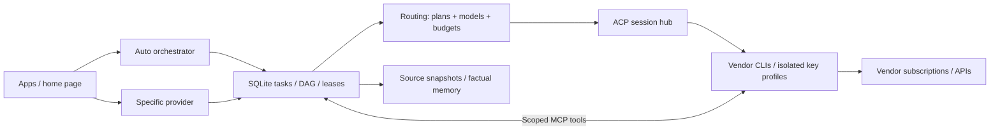

# Agent home

One computer for your agent subscriptions, provider keys and long-running projects.
Use a specific CLI, or let Auto coordinate tasks across your connected providers.

```sh
export RUNNER_TOKEN="$(openssl rand -hex 32)"
docker run --rm -p 127.0.0.1:8090:8090 --env RUNNER_TOKEN \
  -v agent-home:/work ghcr.io/briq-cloud/agent-home:latest
```

Open `http://localhost:8090/?token=<RUNNER_TOKEN>`. Sign in through each vendor's own flow.
Keep the volume: it holds sign-ins, keys, conversations, tasks and memory.
[Briq](https://briq.cloud) is another way to run the same image.

## Two entry points

| Choice | ACP endpoint | Behaviour |
| --- | --- | --- |
| Specific provider | `/acp/auto` with `_meta.agentHome.cli` | Pins that harness and shares task/context services. |
| Auto orchestrator | `/acp/auto` | Persists tasks, selects a route and keeps the conversation pinned. |

Auto considers subscriptions first. API execution and decision-model calls require explicit opt-in.
The page includes chat, task status, permission requests, provider profiles and a terminal.
Raw `/acp/<cli-or-profile>` remains available for full vendor ACP capabilities.
`/acp` remains the compatibility endpoint for subscription load balancing.



## What runs each concept

| Concept | Component | Default / boundary |
| --- | --- | --- |
| Harnesses | Unmodified vendor CLIs + official ACP adapters | Pinned per image. |
| Task orchestration | Our TypeScript executor + SQLite WAL | Durable DAGs, fenced leases, explicit retries. |
| Model routing | OpenRouter metadata + Clef/Jev decision interface | Dynamic routing off; exact approved model bindings. |
| Context caching | Our SHA-256 source/artifact store | Explicit files, revision checks, stable reference prefix. |
| Prompt caching | Each vendor's native cache | No subscription traffic interception. |
| Memory | SQLite FTS5 factual store | Explicit writes, provenance, expiry and deletion. |
| Communication | MCP task tools + durable mailboxes | Delegation off; one coordinator and one child. |
| Deferred work | UTC scheduling + expiring pricing evidence | Per-task opt-in; route/window rechecked at dispatch. |
| Permissions | Vendor ACP requests + user responses | Waits for approval unless an explicit vendor mode is selected. |
| Usage | ACP usage/plan reports | Unknown execution cost stays unknown. |

Research: [T3 Code, Tencent memory and alternatives](docs/research/2026-10-30-architecture.html).
Tencent's gateway and provider batch APIs remain evaluated integrations, not active dependencies.

## Configure and develop

| Setting | Default |
| --- | --- |
| `RUNNER_ORCHESTRATOR` | `1` |
| `RUNNER_DYNAMIC_ROUTING` | `0`; needs an OpenRouter key and per-task decision budget |
| `RUNNER_DELEGATION` | `0`; requires at least two turn slots |
| `RUNNER_MEMORY` | `1`; retrieval and writes remain explicit |
| `RUNNER_DEFERRED` | `1`; individual tasks opt in |
| `RUNNER_TERMINAL_ENABLED` | `1` in the standalone launcher |

```sh
cd runner
npm ci
npm run typecheck
npm test
npm run benchmark -- /tmp/agent-home-benchmark.json
```

[Task/API examples](runner/README.md) · [Architecture](docs/architecture.md) ·
[Image and CLI list](docs/image.md) · [Pinned versions](REFERENCE.md) · [Model benchmarks](benchmarks/README.md)

This is a single-user home. Coordination and path checks do not provide OS sandboxes.
Agents retain the host permissions their CLIs run with.
