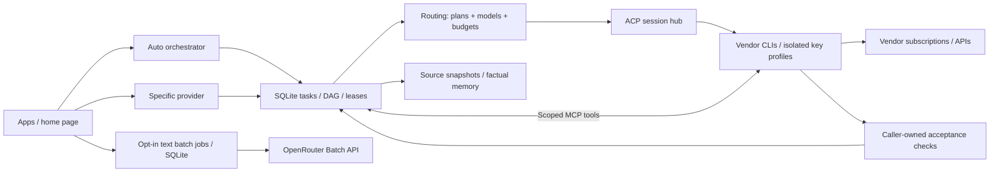

# Agent home

One computer for your agent subscriptions, provider keys and long-running projects.
Use a specific CLI, or let Auto coordinate tasks across your connected providers.

```sh
export RUNNER_TOKEN="$(openssl rand -hex 32)"
docker run --rm -p 127.0.0.1:8090:8090 --env RUNNER_TOKEN \
  -v agent-home:/work ghcr.io/briq-cloud/agent-home:latest
```

Open `http://localhost:8090/?token=<RUNNER_TOKEN>`. Sign in through each vendor's own flow.
Keep the volume: it holds sign-ins, keys, conversations, tasks and memory.
[Briq](https://briq.cloud) is another way to run the same image.

## Two entry points

| Choice | ACP endpoint | Behaviour |
| --- | --- | --- |
| Specific provider | `/acp/auto` with `_meta.agentHome.cli` | Pins that harness and shares task/context services. |
| Auto orchestrator | `/acp/auto` | Persists tasks, selects a route and keeps the conversation pinned. |

Auto considers subscriptions first. API execution and decision-model calls require explicit opt-in.
Dynamic decisions are available by default, but never run without an OpenRouter key and a positive
per-task `decisionBudgetUsd`; set `RUNNER_DYNAMIC_ROUTING=0` to disable them globally. Without both
gates, Auto uses its configured subscription/default route without a decision-model call.
The page includes chat, project registration, a task fleet inspector, permission requests, provider profiles and a terminal.
Raw `/acp/<cli-or-profile>` remains available for full vendor ACP capabilities.
`/acp` remains the compatibility endpoint for subscription load balancing.



## What runs each concept

| Concept | Component | Default / boundary |
| --- | --- | --- |
| Harnesses | Unmodified vendor CLIs + official ACP adapters | Pinned per image. |
| Task orchestration | Our TypeScript executor + SQLite WAL | Durable DAGs, fenced leases, opt-in fleet slots, explicit retries. |
| Model routing | OpenRouter metadata + Clef/Jev decision interface | Dynamic decisions enabled; key and per-task budget required. |
| Context caching | Our SHA-256 source/artifact store | Explicit files, revision checks, stable reference prefix. |
| Prompt caching | Each vendor's native cache | No subscription traffic interception. |
| Memory | SQLite FTS5 factual store; optional BGE-M3 search through OpenRouter | Explicit writes and current-source recall; semantic candidates require opt-in and paid consent. |
| Communication | MCP task tools + durable mailboxes | Delegation off; one coordinator and one child per project. |
| Deferred work | UTC scheduling + OpenRouter SDK batches | Explicit windows; separate opt-in offline text transformations. |
| Permissions | Vendor ACP requests + user responses | Waits for approval unless an explicit vendor mode is selected. |
| Verification | Bounded commands + artifact hashes | Explicit checks; absent checks remain unverified. |
| Usage | ACP usage/plan reports | Unknown execution cost stays unknown. |

Implementation checks: [fleet](docs/benchmarks/2026-10-30-fleet-evaluation.html) ·
[batch](docs/benchmarks/2026-10-30-batch-evaluation.html) ·
[memory retrieval](docs/benchmarks/2026-10-30-memory-retrieval-confirmation.html) ·
[managed tasks](docs/benchmarks/2026-10-30-managed-evaluation.html).
Semantic search returns cited candidates and similarity scores. It never injects them into prompts automatically.

## Libraries

| Component | Library |
| --- | --- |
| Agent transports | `@agentclientprotocol/sdk`, Claude and Codex ACP adapters |
| Scoped task tools | `@modelcontextprotocol/sdk` |
| Provider metadata, decisions and batches | `@openrouter/sdk` |
| Persistence and source hashes | Node SQLite and crypto |
| RPC, WebSockets and validation | `vscode-jsonrpc`, `ws`, `zod` |
| Development checks | TypeScript, Playwright and Promptfoo |

## Configure and develop

| Setting | Default |
| --- | --- |
| `RUNNER_ORCHESTRATOR` | `1` |
| `RUNNER_DYNAMIC_ROUTING` | `1`; decisions require an OpenRouter key and positive per-task `decisionBudgetUsd` |
| `RUNNER_DELEGATION` | `0`; requires at least two turn slots |
| `RUNNER_FLEET_CONCURRENCY` | `2` (or `1` with one turn slot); opt-in `4`, `6`, `8` for separate project folders |
| `RUNNER_MEMORY` | `1`; retrieval and writes remain explicit |
| `RUNNER_SEMANTIC_MEMORY` | `0`; embeddings require an OpenRouter key and per-request paid consent |
| `RUNNER_SEMANTIC_MEMORY_MAX_ESTIMATED_USD` | `0.01`; caller estimate, not a billing cap |
| `RUNNER_DEFERRED` | `1`; individual tasks opt in |
| `RUNNER_BATCH` | `0`; offline text batches require an OpenRouter key and per-job paid consent |
| `RUNNER_BATCH_MAX_ESTIMATED_USD` | `0.05` per job; caller estimate, not a provider billing cap |
| `RUNNER_TERMINAL_ENABLED` | `1` in the standalone launcher |

```sh
cd runner
npm ci
npm run typecheck
npm test
npm run benchmark -- /tmp/agent-home-benchmark.json
```

Save an OpenRouter key with `{ "key":"…", "auto":true }` at `PUT /keys/openrouter` to prepare
the curated, pinned-model Auto pool. Up to four Haiku, Sonnet, DeepSeek and GLM profiles are added
only when their exact versions pass the public catalog checks. The operator can edit or remove
these profiles. Catalog priors are a starting signal, not learned “best model” results. Use
`POST /routing/models` to prepare/refresh and `GET /routing/models` to inspect eligible profiles.

[Task/API examples](runner/README.md) · [Architecture](docs/architecture.md) ·
[Image and CLI list](docs/image.md) · [Pinned versions](REFERENCE.md) · [Model benchmarks](benchmarks/README.md)

This is a single-user home. Coordination and path checks do not provide OS sandboxes.
Agents retain the host permissions their CLIs run with.
