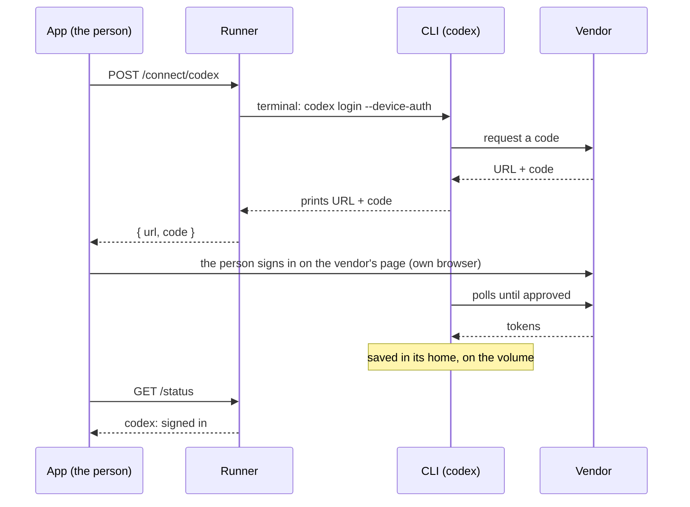
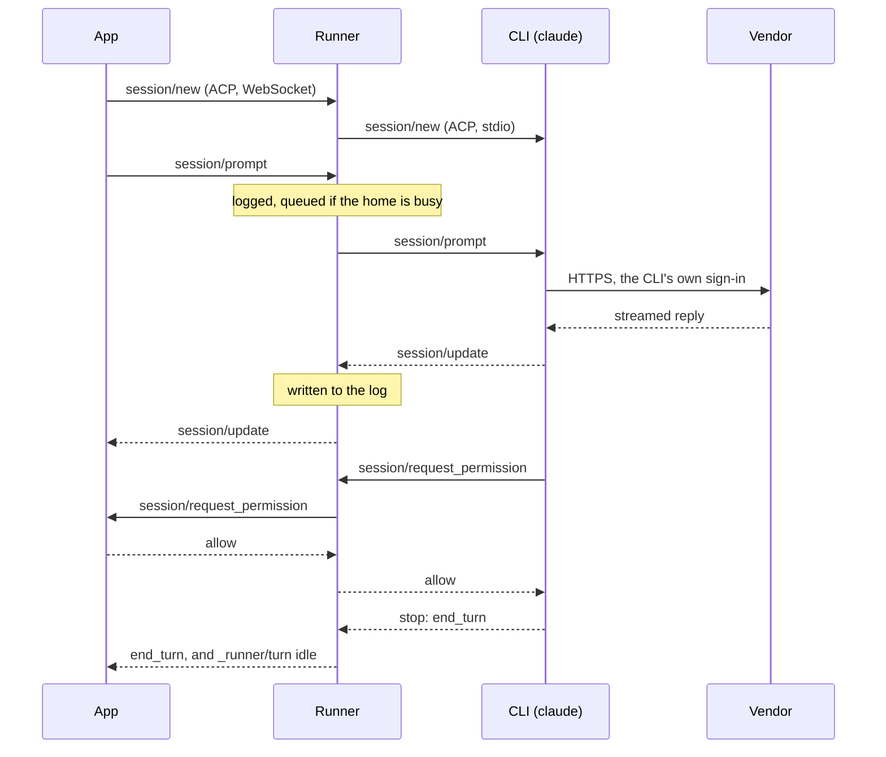

# ACP transport reference

Drives the agent CLIs of an agent home for apps, over ACP (the
[Agent Client Protocol](https://agentclientprotocol.com)), and keeps every session going while no
app is connected. It holds no code per CLI: each CLI speaks ACP itself or through the ACP
project's adapter, and the runner passes ACP messages through as they are.

```text
app ──ACP over WebSocket or HTTP──▶ runner ──ACP over stdio──▶ CLI ──HTTPS, its own sign-in──▶ vendor
```

| CLI | ACP | Sign-in (`/connect/<cli>`) |
| --- | --- | --- |
| `claude` | `claude-agent-acp` (pinned here), on the home's `claude` | `claude auth login`, the person pastes back a code |
| `codex` | `codex-acp` (pinned here), which runs the home's `codex app-server` | `codex login --device-auth` |
| `copilot` | `copilot --acp --stdio` | `copilot login --device-code` |
| `cursor` | `agent acp` | `agent login` |
| `grok` | `grok agent stdio` | `grok login --device-auth` |
| `vibe` | `vibe-acp` | `vibe --setup` |
| `gemini` | `gemini --acp` | a key only: Google's, added on the page, or `GEMINI_API_KEY` in the environment |

and a **profile** for each provider key the person adds (below): `zai-claude`, `openrouter-codex`…

Three ways to sign in, said by `/status` (`signInWith`): `page` (the runner runs the vendor's
command and shows its link and code), `terminal` (the command asks questions first: the page
names it), `api-key` (the CLI counts as signed in when its key is set).

A CLI may offer an ACP sign-in method the home never allows (`blockedAuth`): the runner leaves it
out of the CLI's `initialize` answer and refuses an `authenticate` with it. Gemini's
`oauth-personal` (a personal Google account) is one: its ACP `authenticate` does not check the
image's enforced API-key setting.

The runner is the home's front door: one URL for the person (`/`, the sign-in page, and
`/terminal/`) and for apps (`/acp/<cli>`). The decision and its research: ADR 0021 in briq's
repository.

## Run it

```bash
RUNNER_TOKEN=… node src/main.ts
```

| Variable | Default | |
| --- | --- | --- |
| `RUNNER_TOKEN` | required | The key an app sends: `Authorization: Bearer`, or `?token=` for a browser's WebSocket |
| `RUNNER_PORT` | `8090` | |
| `RUNNER_CWD` | `/work` | Where the CLIs start |
| `RUNNER_STATE` | `/work/.runner` | Session logs, `sessions/<cli>/<id>.jsonl`, mode 0600 |
| `RUNNER_MAX_TURNS` | `2` | Turns at once for the whole home; the rest wait in order |
| `RUNNER_ROUTE` | `claude,codex,cursor,copilot,grok,gemini,vibe` | The CLIs `/acp` may pick, in order of preference; a profile only when named here |
| `RUNNER_LOGINS` | `/work/.logins` | Where the keys (`keys.json`, mode 0600) and each profile's settings folder (`profiles/<name>/`) live |
| `RUNNER_CLIS` | the table above | A JSON array in its place (`src/providers/catalog.ts`, `Cli`) |
| `RUNNER_TERMINAL` | `http://127.0.0.1:7681` | ttyd, started with `--base-path /terminal`, served at `/terminal/` |

Node 22.18 or newer runs the TypeScript as it is. `npm test` runs the runner against a mock
agent; `node test/live.ts claude codex` against a running runner and real CLIs.

## Its API

| | |
| --- | --- |
| `/acp/<cli>` | ACP, as an agent: WebSocket, or Streamable HTTP (`@agentclientprotocol/sdk`'s server transport). One connection is to one CLI and carries any number of sessions |
| `/acp` | ACP, with the runner as one agent (`agent-home`) for every CLI: each `session/new` goes to a CLI (below), every later call to the CLI that holds the session |
| `GET /status` | CLI process, sign-in (`true`, `false`, or `null` when unknown), status source and lifetime. |
| `GET /usage` | What the sessions used, from the logs: per CLI (sessions, turns, tokens, cost, by UTC day, and its last word on its plan's limits) and per session (turns, tokens, cost, context). Below |
| `POST /refresh/<cli>` | Has the CLI refresh its sign-in now: `{ moved, life }`. 409 while a turn of it runs, or when a refresh cannot move its end |
| `POST /connect/<cli>` | Starts sign-in. `{wait:false}` returns immediately; omitted waits for its page/code. |
| `GET /connect/<cli>` | Where it is: `idle`, `starting`, `waiting`, `done`, `failed` |
| `POST /connect/<cli>/input` | `{ text }` typed into it: Claude's code |
| `DELETE /connect/<cli>` | Stops it |
| `GET /` | The home's page, for its person: each CLI signed in or not and until when, its sign-in, its refresh, a link to the terminal. Opened once with `?token=`, which it keeps as a cookie (HttpOnly, SameSite=Strict) and drops from the address |
| `/terminal/` | ttyd, on localhost behind the runner: the page and its WebSocket. The runner's key and cookie never reach it |
| `GET /keys` | Each provider: whether its key is set (never the key), its billing (`plan` or `use`), the harnesses that can run it; and the profiles |
| `PUT /keys/<provider>` | `{ key }`: kept on the home. Its profiles and the CLI that takes it start again with it on their next use |
| `DELETE /keys/<provider>` | Forgets it |
| `POST /profiles` | `{ provider, harness, model? }`: a CLI of its own, `/acp/<provider>-<harness>` |
| `DELETE /profiles/<name>` | Removes one; its session logs stay |
| `GET /healthz` | No key |

**What the runner adds to ACP**, all of it standard ACP otherwise:
- **`initialize`** is answered with the CLI's own answer: one ACP process per CLI, started on
  first use and again after it exits, serves every connection.
- **`session/load`** replays the session from the runner's log (the prompts, every
  `session/update`), then follows it live. A CLI process that no longer holds the session (it
  restarted) loads it again; its own replay is dropped.
- **A request from the CLI** (`session/request_permission`) goes to every app following the
  session; the first answer wins. With none there, it waits, and the next app that loads the
  session gets it.
- **`_runner/turn`**, a notification: `{ sessionId, state: "queued", position }`, `"running"`,
  `"idle"` with the `stopReason`. In the log too, so an app that comes back knows where the turn
  is (the response to `session/prompt` goes only to the connection that sent it).
- **One at a time** for Claude and Codex: their refresh tokens work once, and two processes
  refreshing together sign the person out. Sessions start one after the other (a start is a new
  process, which may refresh first), and a prompt waits until the one before has had its first
  answer from the model, 30 s at most.

**`/acp`, one agent for every CLI.** `initialize` announces what every CLI supports (text
prompts, stdio MCP servers, `session/load`), and starts nothing. A `session/new` goes to:
1. the CLI it asks for: `_meta: { agentHome: { cli: "codex" } }`;
2. else the least busy of the CLIs in `RUNNER_ROUTE` (default `claude,codex,cursor,copilot,grok,gemini,vibe`,
   the earlier first), leaving out one signed out and one at its plan's limit, and putting last
   one whose plan is nearly used up (a window at 90% or more in its last report: Claude's
   `unifiedWindows`).

A CLI is at its limit when a turn fails on it (a rate or usage limit in the error), or when it
says so (Claude's `_claude/rateLimit` with status `rejected`): until its reset, 15 minutes when it
gives none. `/status` lists them (`limited`). The answer is the CLI's own `session/new` answer,
with `_meta.agentHome`: the CLI's name and its own capabilities (images, HTTP MCP servers…). A
session stays on its CLI: one at its limit fails its turns, and the app opens a new session.

**What a CLI does not get**: the client's file system or terminal (each uses its own tools, in
the home), or the runner's environment. It sees an allow-list (`src/providers/catalog.ts`): the CLI homes, the
credential gateway's proxy and CA, a vendor's API-key placeholder when the home has one.

**Choosing from the app**: the CLI is the endpoint; its modes and config options (model,
effort…) come in the `session/new` answer, set with `session/set_mode` and
`session/set_config_option`; MCP servers go in `session/new`'s `mcpServers`.

## A home as a local agent: `agent-home-acp`

For an ACP client that only starts agents on its own machine (Zed, JetBrains, VS Code, `acpx`):
`bin/agent-home-acp.ts` speaks ACP on stdin and stdout and relays it to a home's runner.

```json
{ "agents": { "home": { "argv": ["node", "agent-home-acp.ts", "wss://home-x7k2.briq.run/acp"] } } }
```

`AGENT_HOME_TOKEN` is the runner's key, `AGENT_HOME_BRIQ_TOKEN` the private URL's token (sent as
its cookie). The client's folder does not exist on the home: a session's `cwd` becomes
`AGENT_HOME_CWD`, or `/work/<the folder's name>`. The agent works on the home's files, not the
laptop's. Measured on the staging home: `acpx` through it, Codex in 11 s, `/acp` (Claude) in 6 s.

## Keys and profiles

A provider the person brings a key for runs on a harness of the image: Claude Code on an
Anthropic-compatible endpoint, Codex on one that serves OpenAI's Responses API (the only API Codex
speaks since 2026-02). The table is `src/providers/profiles.ts`:

| Provider | Billing | Claude Code | Codex |
| --- | --- | --- | --- |
| `zai`, GLM Coding Plan | plan | `api.z.ai/api/anthropic`, model optional | |
| `kimi`, Kimi Code | plan | `api.kimi.com/coding/`, a model | |
| `minimax`, MiniMax Token Plan | plan | `api.minimax.io/anthropic`, a model | |
| `alibaba`, Alibaba Coding Plan | plan | `coding-intl.dashscope.aliyuncs.com/apps/anthropic`, a model | |
| `deepseek` | use | `api.deepseek.com/anthropic`, model optional | |
| `openrouter` | use | `openrouter.ai/api`, a model | `openrouter.ai/api/v1`, a model |
| `google`, Gemini API | use | the `gemini` CLI takes it | |

A profile is `<provider>-<harness>`, a CLI of its own: the harness's adapter, with the provider's
endpoint and key and the model (all of Claude Code's model names set to it), in a settings
folder of its own under `RUNNER_LOGINS/profiles/`. Never the person's own Claude or Codex folder:
the harness would send their subscription's token to another vendor. Claude Code's non-essential
traffic is off (nothing to Anthropic with another vendor's key). A Codex profile's provider is in
its `config.toml`, its key in a variable that file names.

Keys live on the home, in one file only the runner's user reads; the API never sends one back.
They are as safe as the sign-ins beside them: any process on the home can read both (ADR 0021,
plan). `/acp` never picks a profile unless `RUNNER_ROUTE` names it: a key may be billed by use.
`/usage` leaves out a profile's cost, which Claude Code reckons at Anthropic's prices.

Measured with the real harnesses against a fake provider on localhost (2026-10-29): Claude Code
2.1.304 through `claude-agent-acp` 0.98.0 sent one request, `/v1/messages`, with the profile's key and model and nothing
else; Codex 0.165.0 called `/api/v1/responses` with the key and the model, and answered (with a
warning that it has no metadata for the model).

## Usage

Read from the session logs, so it survives restarts. What each CLI reports through ACP:

| | Tokens (`usage` in the `session/prompt` answer, unstable ACP) | Cost (`usage_update.cost`) | Context (`usage_update.used`/`size`) | Plan limits |
| --- | --- | --- | --- | --- |
| Claude | yes | yes, at API prices: notional on a subscription | yes | `_meta["_claude/rateLimit"]` on a `usage_update`: a status (`allowed`, `allowed_warning`, `rejected`) and how much of each window is used (`unifiedWindows.five_hour`, `seven_day`: `utilization`, `resetsAt`) |
| Codex | yes | no | yes | no: its adapter keeps them and shows them only as the text of `/status` |

Both are a session's running totals; a turn's share, counted on the day it ended, is the
difference with the turn before. A plan's limits are passed on as the CLI gave them (`limits`:
the `_meta` key and its value), for the app to read.

Measured on a `small` home (2026-10-28): a Claude turn that writes a file and runs a command, 24.7k
tokens (24.5k of them cached reads), 0.05 USD at API prices; the same with Codex, 15.1k tokens.

## How long a sign-in lasts

`life` in `/status`, read from the dates of the CLI's sign-in file (never its tokens):

| | `endsAt` | `renews` | |
| --- | --- | --- | --- |
| Claude | about 29 days after the sign-in, used or not | `false`: only a new sign-in moves it | `accessEndsAt`: 8 hours, refreshed on the next use |
| Codex | 30 days after the last refresh | `true` | `refreshableAt`: 8 days after the last refresh, Codex refreshes on a use |
| The others | not read yet | | |

`endsSoon` is a week before `endsAt`: show the person a sign-in or call `/refresh`.

`POST /refresh/<cli>` stops the CLI's process (none then holds the old token in memory; its
sessions load again on their next use) and runs one short turn in a session no app sees, which
refreshes the sign-in as any use does. It costs that turn's tokens. Before `refreshableAt`, the
CLI does not refresh and `moved` is `false`. A home asleep refreshes nothing: the app calls
`/refresh` (which wakes it) when `refreshableAt` has passed and `endsAt` comes near.

## Sign-in

The vendor's own command, in a terminal (`script`). The runner reads the page's address and the
code from what it prints and passes back what the person types. The person approves in their own
browser; the token goes from the vendor to the CLI's file on the home's volume. ACP has no sign-in
of its own for these CLIs (their method is "run this in a terminal"), so this is outside ACP.



## A turn



## Measured on a `small` home (2026-10-28, staging)

| | Claude | Codex |
| --- | --- | --- |
| A turn that writes a file and runs a command, one permission | 7 s | 14 s |
| The app leaves mid-turn and loads the session again | replayed, then live | replayed, then live |
| Two sessions at once | 11 s and 14 s, 0.66 GB used | |
| Two sessions started at once, the access token expired | both done (19 s, 14 s), refreshed once, still signed in | |
| Processes | one adapter, one `claude` per session | one adapter, one `codex app-server` |


## The home page

The page includes a same-origin ACP chat: choose a CLI or Auto, send a message, and answer any
permission request. Stop cancels the turn; reloading can resume the last conversation from the
runner's log. Terminal opens in a separate tab. The copy icon copies the private home link for
another browser; vendor sign-in links have their own copy buttons.

Saving an OpenRouter key prepares the curated Auto model pool. Advanced keeps explicit harness
and model profiles. See the [profile API](../runner/README.md#profiles).

Sign-in progress polls `GET /connect/<cli>` independently every 500 ms while active. Browser/code
steps and completion update without waiting for slower overall account checks. Vibe uses its
read-only ACP `_auth/status`; no prompt or model call is needed.

A CLI with no status command reports a recorded successful sign-in (`statusSource: "sign-in"`),
not a live check. Only its completion date is stored in `.runner/sign-ins.json`; a vendor token
is never read for this. A CLI signed out in another terminal may need a new sign-in.
